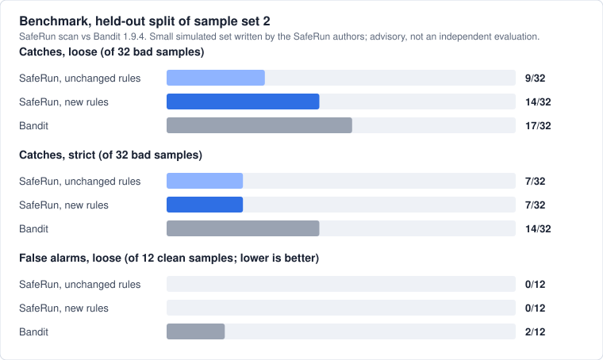

# SafeRun

Checks AI-generated code before you run or trust it. Executing untrusted code in a sandbox **limits the impact** of that
code; it does **not** prove the code is safe, and a passing scan does not guarantee security.
**Current release: 0.0.2** · [PyPI](https://pypi.org/project/saferun-cli/) · [GitHub Releases](https://github.com/vinay-repalle/saferun/releases) · [Website](https://safe-run.netlify.app) · [Security policy](https://github.com/vinay-repalle/saferun/blob/main/SECURITY.md)

Status: **alpha, not independently certified or security-audited.** The signed analyzer image `analyzer-v1.2.0` is published from this repository and recorded in `ANALYZER_RELEASE`, so `saferun init` installs it after verifying its cosign signature; see [docs/release-images.md](https://github.com/vinay-repalle/saferun/blob/main/docs/release-images.md). Only a small, advisory benchmark exists (SafeRun's own simulated samples against Bandit and pip-audit, see [docs/benchmark.md](https://github.com/vinay-repalle/saferun/blob/main/docs/benchmark.md)); not yet done: an independent detection-quality evaluation, and verification of the Docker sandbox through Docker Desktop on Windows and macOS (see [docs/platforms.md](https://github.com/vinay-repalle/saferun/blob/main/docs/platforms.md)). **The CLI is the product**; `web/` is a static informational website.

**Requirements:** Python 3.12 or newer and Docker (running Linux containers). Linux, Windows and macOS are supported; Linux is the fully tested platform.

## Install in four commands
```bash
pip install saferun-cli     # the PyPI package is saferun-cli; the command it installs is `saferun`
saferun init                # one-time setup: checks Docker, fetches a verified cosign, installs the signed analyzer image, downloads the OSV data
saferun doctor              # read-only diagnosis: PASS / WARNING / FAIL per check, with the fix for each problem
saferun run my_script.py    # scan the script; run it only inside the hardened sandbox if the scan allows it
```
You do **not** install cosign or download the OSV database yourself. **Docker is the only prerequisite you install separately.**
`pipx install saferun-cli`, `uv tool install saferun-cli` and `poetry add saferun-cli` work as well. Requirements: Python 3.12 or newer, and for Poetry **version 2.0 or newer** (Poetry 1.x, including the 1.8 that Ubuntu 24.04 packages, cannot read this package's wheel metadata; use `pipx install poetry` or `pip install -U poetry`).

## License
SafeRun is released under the [MIT License](https://github.com/vinay-repalle/saferun/blob/main/LICENSE) (Copyright (c) 2026 Vinay Repalle). The analyzer image also redistributes third-party software under its own licenses (Semgrep, OSV-Scanner, gitleaks and others); their notices are in [docker/analyzer/THIRD_PARTY_NOTICES.md](https://github.com/vinay-repalle/saferun/blob/main/docker/analyzer/THIRD_PARTY_NOTICES.md) and inside the image.

## Key features
- **Restricted Docker sandbox** (Phase 1): read-only sanitized project copy, no network, non-root, no capabilities, resource limits, verified at run time.
- **Validation engine** (Phase 2): Python syntax check (a "can the scanner read this file" step: it parses the file, it does not run it) in the sandbox; Semgrep (Python), an **offline** OSV-Scanner dependency scan and a **hardcoded-secrets scan** (gitleaks), all run **only inside a verified, locked-down analyzer container** (Phase 5B, no host-side fallback); one normalized report and a PASS / WARNING / FAIL verdict.
- **CLI** (Phase 3): `saferun scan PATH`, text or JSON output, deterministic exit codes. Incomplete scans never report PASS.

## Prerequisites
**Docker, running Linux containers and reachable by your user.** Remote Docker endpoints are refused (the project is bind-mounted by host path). The daemon must provide cgroup limits (memory, swap, pids, CPU) and seccomp.

| Platform | Install Docker | Notes |
|---|---|---|
| Linux | [Docker Engine](https://docs.docker.com/engine/install/); then `sudo usermod -aG docker $USER` and log in again | Fully tested platform. |
| macOS | [Docker Desktop](https://docs.docker.com/desktop/setup/install/mac-install/) (or Colima / OrbStack); start it once | Host code tested in CI; Docker Desktop integration not verified. |
| Windows 10/11 | [Docker Desktop](https://docs.docker.com/desktop/setup/install/windows-install/) with the WSL 2 backend, **Linux containers** mode | Native Windows host code, no WSL needed for SafeRun itself; Docker Desktop integration not verified. |

`saferun init` and `saferun doctor` tell you exactly which of these is wrong (Docker missing, daemon not running, permission denied, remote endpoint) and what to do. Details: [docs/platforms.md](https://github.com/vinay-repalle/saferun/blob/main/docs/platforms.md).

## Install and set up
```bash
pip install saferun-cli
saferun init            # interactive: shows what is installed, offers the rest. For scripts/CI: saferun init --all   (also --only, --skip, --yes, --repair)
saferun doctor          # PASS / WARNING / FAIL, exit 1 if anything FAILED. --online also re-verifies the release signature; --format json for tools
saferun status          # which components are installed and verified (exit 0 only if everything is ready)
```
What `saferun init` does, in order, and what it never does:
1. **Checks the host and Docker** (OS, installed, daemon running, permissions, local endpoint) and prints platform-specific guidance if something is missing. If Docker is unusable nothing is installed.
2. **Pulls the sandbox images by pinned digest** (python) and re-checks the digest afterwards.
3. **Installs the analyzer image** (Semgrep, OSV-Scanner, gitleaks, rules): it first obtains **cosign** by itself if you have none (a pinned release, downloaded over HTTPS into SafeRun's own data directory and accepted only if its SHA-256 equals the value written in SafeRun's source; it is re-hashed on every use), then verifies the image's **signature and identity** (this repository's release workflow on an `analyzer-v*` tag) **before anything is pulled**, pulls it by digest, checks digest, labels, tool versions and rules hash, and locks it. There is no unsigned install; `--build-local` is the explicit alternative and needs a source checkout.
4. **Downloads and caches the OSV vulnerability data** (about 260 MB, public data from `osv-vulnerabilities.storage.googleapis.com`, nothing about your projects is sent) into your user data directory with integrity hashes. Only what is missing, invalid or older than 30 days is downloaded; a current database is left alone. Failed downloads are retried and never replace good data. If the data cannot be refreshed, `init` says how old the existing data is and scans report the dependency check as INCOMPLETE; **stale data is never treated as current**. Refresh later with `saferun osv-db update` (`--if-stale` to skip when it is current).
5. **Verifies everything again** and prints a result per component.

`saferun init` skips what is already valid, so it is safe to re-run (for example after an analyzer release).

**Upgrading:** `pip install --upgrade saferun-cli`, then `saferun init` and `saferun doctor`. Check the installed version with `saferun --version`. Releases are listed on [PyPI](https://pypi.org/project/saferun-cli/#history) and [GitHub](https://github.com/vinay-repalle/saferun/releases). Developers working from a checkout: `pip install -e '.[dev]'`, then `pytest -q` (Docker tests skip loudly without Docker; `SAFERUN_REQUIRE_DOCKER=1` makes them fail instead).

**Clean-environment install and validation, and what the CI runs:** [docs/install-and-test.md](https://github.com/vinay-repalle/saferun/blob/main/docs/install-and-test.md).

## Quick start
**`scan` vs `run`:** `saferun scan` only *reads* files and **executes nothing** (project code is never run). `saferun run` scans a script first, and only if the verdict allows it executes the script inside the hardened sandbox.
```bash
saferun scan ./my-project                 # human-readable report; nothing is executed
saferun scan ./my-project --format json   # machine-readable report (schema_version 1)
saferun run my_script.py -- arg1 arg2     # scan first, then run inside the sandbox only if allowed
saferun scan ./my-project --accept-file ~/accepts.toml   # dependency findings you have reviewed and accepted until a date (reason required; see docs/cli.md)
saferun check-names --project ./my-project   # separate, offline: dependency names that look like typos of popular PyPI packages
```
Exit codes of `scan`: **0** PASS · **1** FAIL · **2** WARNING (including any incomplete scan) · **64** invalid usage/path · **70** fatal · **130** interrupted.

### `saferun run`: what it does and what it guarantees
`saferun run SCRIPT [-- ARGS...]` scans the Python script with the normal checks and then runs it **only inside the same hardened Docker sandbox** used for checks: pinned `python:3.12-slim` image, **no network**, read-only root and project, non-root user, no capabilities, memory/CPU/pids/time limits, output cap, secrets redacted from output. It never runs anything on the host.
- Only the script itself is copied and scanned (`--project-dir DIR` scans and mounts a whole directory that contains it). Options go **before** the script name (`--timeout SECONDS`, default 30).
- **PASS** → it runs. **FAIL** → refused (exit 1). **WARNING** → refused (exit 2) by default. `--allow-warnings` accepts a WARNING only from a **complete** scan with no high/critical finding; an incomplete, errored, timed-out, skipped or unavailable check is never overridden, and neither is a FAIL.
- If the scan cannot be carried out (analyzer or Docker unusable, internal error) the script is **not** run (exit 70).
- A PASS means the checks found nothing they know about; it is **not** proof that the script is safe. The sandbox limits the impact of the code, it does not make it harmless. Scripts that need the network or third-party packages will fail inside it.
- Exit codes: **0** the script ran and exited 0 · **1** refused: FAIL · **2** refused: WARNING · **3** the script ran but exited non-zero, timed out or was killed · **64** usage · **70** could not scan or sandbox · **130** interrupted.

> **Privacy / network:** scans never use the network. Semgrep, OSV-Scanner and gitleaks run in a container without network access (gitleaks never checks whether a secret is live), and OSV-Scanner reads a local copy of the OSV data (`saferun osv-db update`, an explicit download of public data that contains nothing about your project). Without that data the dependency check reports `error` (verdict at best WARNING). Per-scan *online* OSV queries were removed in Phase 5B, see [PROJECT.md](https://github.com/vinay-repalle/saferun/blob/main/PROJECT.md). The separate `saferun check-names` command is offline too (bundled list of popular package names); only with its opt-in `--online` flag does it send package names (never code) to pypi.org, and a failed lookup is reported as "could not check", never as a pass. See [docs/cli.md](https://github.com/vinay-repalle/saferun/blob/main/docs/cli.md).
>
> **Limits of the OSV data checks:** the download is checked against the server's MD5 header (refused if absent) and a SHA-256 is recorded locally and re-checked before every scan. That detects corruption and later modification of the files. It does **not** authenticate the download (the hash comes from the same server, or from your own disk), and someone who can write the data directory can rewrite the manifest too. Data older than 30 days makes the dependency check `incomplete`.

## Security and reporting problems
Alpha software: the sandbox limits the impact of code, it does not make code harmless, and PASS is not proof of safety (see [PROJECT.md](https://github.com/vinay-repalle/saferun/blob/main/PROJECT.md) for the known exposures). Report vulnerabilities **privately** through GitHub's private vulnerability reporting, as described in [SECURITY.md](https://github.com/vinay-repalle/saferun/blob/main/SECURITY.md); do not open a public issue with details.

## Website (static)
`web/` is a static informational site (what SafeRun is, the PyPI install, features, security model, platforms, setup guide, links to GitHub, PyPI and Releases). It has no backend and does not scan anything.
```bash
cd web && npm ci --ignore-scripts && npm test && npm run build   # output: web/dist
```
**Hosting:** Netlify. **Live site:** https://safe-run.netlify.app · **Repository:** https://github.com/vinay-repalle/saferun

| Netlify setting | Value |
|---|---|
| Deployment branch | `main` |
| Base directory | `web` |
| Build command | `npm ci --ignore-scripts && npm run build` |
| Publish directory | `dist` |
| Node.js | 22 |

Pages are switched by the URL hash, so no redirect rules are needed.

> **Scope:** the website is a static informational site only. SafeRun's CLI, sandbox and security analysis stay in this repository (`saferun/`, `docker/`) and run on your own machine; none of that is hosted by Netlify, and the site scans nothing.

## Secrets scan (hardcoded passwords, keys, tokens)
`saferun scan` also looks for secrets committed to project files with **gitleaks**, run inside the same verified analyzer container as Semgrep and OSV-Scanner (no network, read-only project, no host fallback). Every secret found is a **HIGH** finding (verdict FAIL). The report shows the rule, the file and the line, **never the secret itself**. Turn it off with `--no-secrets-check` (the check is then `skipped` and the verdict is at best WARNING); if the analyzer image is missing, outdated or unusable the check is `unavailable`/`error`, never a pass. After upgrading SafeRun, run `saferun init` to get an analyzer image that contains gitleaks; until then every scan reports this check as not run.
**What it cannot do (read before relying on it):** it matches known vendor token formats (cloud and SaaS API keys, private keys, and similar), so a plain password in a config file, an internal token with no recognisable format, or a secret that was split or encoded is **not** found. The noisy generic "high-entropy value next to a key-like name" rule is switched off to keep false alarms low; the cost is that fewer secrets are found. It can still raise false alarms (a documentation example or a test fixture that looks like a real key), and it does **not** check whether a found secret is live or revoked (nothing is sent anywhere). Binary files and files over 1 MB are not scanned (the latter make the check INCOMPLETE); `node_modules`, `.venv`, `venv` and `site-packages` are skipped; a project's own gitleaks configuration, `.gitleaksignore` and `gitleaks:allow` comments are ignored. Files whose content matches SafeRun's own credential signatures (private keys and a few token formats) are already withheld at copy time and reported by `workspace-sensitive-files`. A secret in a *dependency* or in git history is out of scope. Details: [docs/cli.md](https://github.com/vinay-repalle/saferun/blob/main/docs/cli.md).

## Plain-English findings
Under each finding the text report adds one short line, **"In plain words:"**, saying what it is, why it matters and how to fix it, with the exact technical term kept (`shell=True`, `pickle`, command injection). It is shown by default, and the same text is in the JSON finding as `explanation` (only when one exists). The original `message` is unchanged. The texts are written with "can" and "could": a finding is a warning sign, not proof of an attack, and a fix does not guarantee safety. Findings with no known text show no line.

## Supported runtimes
| Runtime | Image | Status |
|---|---|---|
| Python | `python:3.12-slim` | sandbox, syntax check and Semgrep implemented (the secrets scan reads files of any type) |

SafeRun is **Python-only**. JavaScript/Node.js projects are not analysed: JavaScript files get no syntax check or code rules, and npm lockfiles are not scanned (the dependency check says so in a plain note and never counts it as a clean pass). The secrets scan reads files of any type.

## Benchmark (advisory)



On the held-out part of a second sample set, three new Python rules raised SafeRun's loose catches from 9/32 to 14/32 with no new false alarms (0/12). SafeRun is still behind Bandit (17/32 loose, 14/32 strict), and its strict catches did not change because the new rules are medium severity. The dependency check ties with pip-audit (8/8 on the first set). The samples are small, simulated and written by the SafeRun authors, so this is not an independent evaluation. Details, limits and the per-sample misses: [docs/benchmark.md](https://github.com/vinay-repalle/saferun/blob/main/docs/benchmark.md).

## Documentation
- [docs/cli.md](https://github.com/vinay-repalle/saferun/blob/main/docs/cli.md) — CLI options, exit codes, output examples
- [docs/engine.md](https://github.com/vinay-repalle/saferun/blob/main/docs/engine.md) — validation engine: checks, dependency coverage, statuses, verdict rules
- [docs/install-and-test.md](https://github.com/vinay-repalle/saferun/blob/main/docs/install-and-test.md) — clean-environment install, validation, CI
- [docs/benchmark.md](https://github.com/vinay-repalle/saferun/blob/main/docs/benchmark.md) — benchmark of the scan against Bandit and pip-audit (dev tool, advisory, small simulated sample set)
- [docs/platforms.md](https://github.com/vinay-repalle/saferun/blob/main/docs/platforms.md) — Linux, Windows and macOS status and evidence
- [docs/release-pypi.md](https://github.com/vinay-repalle/saferun/blob/main/docs/release-pypi.md) — maintainer procedure for PyPI releases
- [docs/sandbox.md](https://github.com/vinay-repalle/saferun/blob/main/docs/sandbox.md) — sandbox library usage and guarantees
- [PROJECT.md](https://github.com/vinay-repalle/saferun/blob/main/PROJECT.md) — goals, architecture, threat model, known exposures (**read before relying on the sandbox**), phases
- [IMPLEMENTATION.md](https://github.com/vinay-repalle/saferun/blob/main/IMPLEMENTATION.md) — status, test evidence, limitations, technical notes
